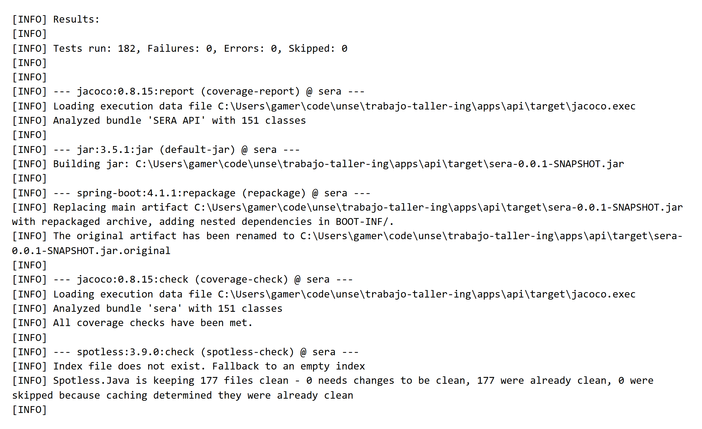
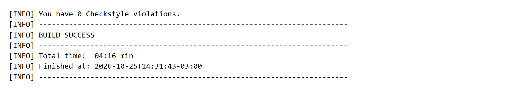
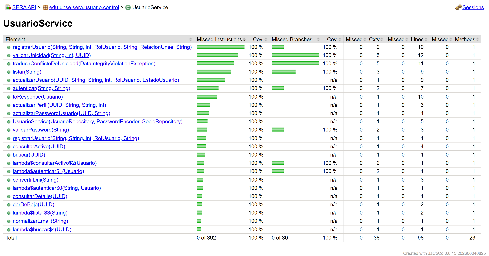
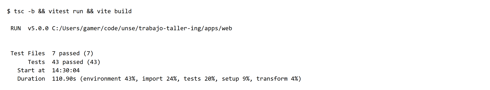

# Informe de pruebas de SERA

Ingeniería de Software · Universidad Nacional de Santiago del Estero  
Integrantes: Axel Castaño, Marcos Mendez, Jorge Taboada y Luciano Ordoñez  
Fecha de ejecución: 25 de octubre de 2026

## 1. Objetivo y alcance

Comprobamos el acceso de usuarios a SERA mediante pruebas de registro, autenticación, sesiones, perfil y permisos de administración. La clase principal evaluada fue `UsuarioService`. También probamos los controladores y el filtro de sesión para verificar las respuestas de la API.

El ingreso físico al polideportivo mediante QR pertenece a otra funcionalidad y queda fuera de este alcance específico.

## 2. Método de trabajo

Utilizamos Java 21, JUnit, AssertJ y Mockito para las pruebas unitarias. Los repositorios simulados permitieron preparar cuentas activas, inactivas, inexistentes y duplicadas. Una prueba adicional utilizó BCrypt real para comprobar el almacenamiento y el cambio de contraseña.

Las pruebas HTTP se ejecutaron con MockMvc y la configuración real de seguridad, con los servicios simulados. JaCoCo 0.8.15 midió la cobertura desde Maven. En la interfaz utilizamos Vitest.

La verificación final del servidor se realizó con `mvnw.cmd clean verify`. Para la interfaz se ejecutaron `pnpm lint`, `pnpm format-check` y `pnpm build`, que incluye las pruebas y la compilación. Los resultados de este informe corresponden a esa ejecución, sin repetir las pruebas para preparar las capturas.

## 3. Casos probados

Los siguientes grupos resumen las situaciones verificadas y sus resultados esperados. Todos aprobaron en la ejecución final.

- Registro. Con datos válidos, crear una cuenta activa y su socio, normalizar el correo y guardar la contraseña como hash. Rechazar un correo o DNI duplicado.
- Autenticación. Permitir el ingreso de una cuenta activa con credenciales correctas. Rechazar cuentas inexistentes o inactivas y contraseñas incorrectas.
- Contraseñas. Aceptar el límite de 72 bytes en UTF-8 y rechazar el exceso. Después de un cambio, aceptar la contraseña nueva y rechazar la anterior.
- Sesiones. Crear una sesión nueva al autenticar e invalidar la anterior. Impedir su reutilización después del cierre o de la baja de la cuenta.
- Permisos. Impedir que el registro público asigne un rol administrativo. Rechazar operaciones de administración para usuarios sin ese permiso y aplicar los cambios de rol en la siguiente solicitud.
- Perfil y validaciones. Usar la identidad de la sesión e impedir cambios de rol o estado desde el perfil. Rechazar datos inválidos y escrituras sin el token CSRF que protege contra solicitudes falsificadas.

Estos grupos reunieron 66 casos automatizados de Control y Boundary, incluidos los parametrizados, dentro del conjunto de pruebas del servidor.

## 4. Resultados y evidencias

### Ejecución del servidor

Se aprobaron las 182 pruebas del servidor, sin fallos, errores ni casos omitidos. Maven también confirmó el cumplimiento del umbral de cobertura y la comprobación de formato con Spotless.

*Figura 1. Resultado de las pruebas del servidor y verificación de cobertura.*

El proceso terminó correctamente, con cero infracciones de Checkstyle y el empaquetado de la aplicación completado.

*Figura 2. Cierre de la verificación del servidor.*

### Cobertura del acceso de usuarios

El alcance de autenticación, sesión y permisos comprende los paquetes `usuario.control` y `usuario.boundary`, junto con `SecurityConfig` y `PasswordConfig`. JaCoCo registró sus 288 líneas y 44 ramas cubiertas, equivalentes al 100% en ambas medidas.

En `UsuarioService` se cubrieron las 98 líneas y las 30 ramas contabilizadas. Las ramas representan las salidas de las decisiones del código que recorrieron las pruebas.

*Figura 3. Cobertura de UsuarioService. Las columnas Cov. muestran instrucciones y ramas; Lines indica el total de líneas y Missed las no cubiertas.*

El 100% corresponde únicamente al alcance indicado. En el servidor completo se cubrió el 69,79% de las líneas y el 54,33% de las ramas.

### Interfaz y comprobación con PostgreSQL

Las 43 pruebas de la interfaz aprobaron. También finalizaron correctamente las comprobaciones de tipos, formato y análisis estático, junto con la generación de la aplicación web.

*Figura 4. Resultado de las pruebas de la interfaz.*

Se comprobó además el arranque con una base PostgreSQL vacía, la aplicación de la migración y la validación del esquema. El recorrido HTTP con persistencia real aprobó registro, duplicados, autenticación, perfil, protección CSRF, permisos, cambio de rol y contraseña, cierre de sesión y baja.

## 5. Evaluación del resultado

Los casos ejecutados respondieron según lo esperado y se cumplió el objetivo de cobertura del acceso de usuarios. Esto respalda el comportamiento probado en la versión evaluada, pero no demuestra que el sistema esté libre de errores.

Las pruebas con repositorios simulados no comprueban por sí solas las consultas ni la concurrencia en PostgreSQL. Tampoco se evaluaron todas las combinaciones de datos ni el funcionamiento bajo carga. Si cambia el código, deberán repetirse las comprobaciones correspondientes antes de utilizar estos resultados para una nueva entrega.
